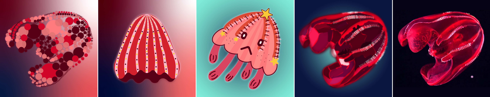
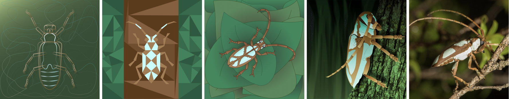

[← MEDIAART 2DF3](README.md) | [Project 2](P2-README.md)

---

# P2 – In-Class Work I: Research, Sketching & First Composition

*Project 2 – In Pairs with Individual Work*

<figure style="width: 100%; margin: auto;">
  
  
  <figcaption style="text-align: center; font-style: italic; margin-top: 0.5em;">
    Examples by previous students: Winter 2026 (top) & Fall 2026 (bottom).
  </figcaption>
</figure>

---

## Goal

During Part 1, each pair will develop the **concept, visual direction, research, and initial sketches** for a series of four compositions based on an assigned animal.

The project should build on concepts and techniques developed throughout  **all Composition Techniques**, applying principles of form and spatial relationships, repetition and variation, shape and structure, texture, colour, Gestalt principles, visual hierarchy, composition, visual style, and image-making and representation to develop intentional and cohesive visual interpretations of the assigned animal.

---

## Software

- **Adobe InDesign** — planning and project documentation
- **Adobe Illustrator** — vector-based composition and illustration
- **Adobe Photoshop** — raster-based composition, image manipulation, collage, texture, and digital painting

> **Do not use Image Trace in Adobe Illustrator or automated tracing techniques to generate the compositions.**

## Complete the activity in three stages

Complete the following stages in order.

<!-- 
/////////////////
SECTION 1
/////////////////
-->

  

    Stage 1: Research, develop the visual direction, and create the planning document
    
      Research the assigned animal, establish a cohesive visual direction for the four compositions, and assemble the concept, references, and sketches in Adobe InDesign.
    
  

#### Research the assigned animal

Before sketching, **research the assigned animal**. Your research should help you understand its visual characteristics rather than simply provide images to copy. Consider:

- Overall shape
- Anatomy
- Proportion
- Movement
- Texture
- Surface patterns
- Colour
- Silhouette
- Distinctive features
- Habitat
- Scale
- Behaviour

Collect several visual references showing the animal from **different perspectives**. Look for:

- Full-body photographs
- Close-up details
- Different viewpoints
- Surface textures and patterns
- Movement or body positions
- Anatomical references

> Use the research to identify what makes the animal visually distinctive and what characteristics could be preserved, exaggerated, simplified, fragmented, or abstracted.

---

#### Develop the pair's visual direction

Although each composition is created individually, the four works must function together as a **cohesive series**.

Discuss how the compositions will relate visually while still allowing each student to develop an individual approach.

##### Representation

Decide:

- Which student will create the **realistic composition**
- Which student will create the **figurative composition**
- How the two abstract compositions will differ from one another
- Which visual characteristics of the animal should remain recognizable across the series

**Realistic composition:** Represents the animal as closely as possible to its natural appearance, maintaining accurate proportions, anatomy, shapes, textures, and distinctive physical characteristics. The goal is to achieve visual accuracy through digital illustration, painting, or image manipulation.  

**Figurative composition:** Represents the animal through a stylized interpretation. The animal must remain clearly recognizable, but its shapes, proportions, colours, and textures can be simplified, exaggerated, distorted, or reinterpreted. The goal is to develop a distinct visual style while maintaining a recognizable subject. Possible applications: Cartoonish, Expressive, Decorative, etc.   

**Abstract composition:** Transforms the animal's visual characteristics into a composition of shapes, lines, colours, textures, patterns, and spatial relationships. The animal does not need to be immediately recognizable as a complete figure, but the composition must demonstrate a meaningful visual connection to its morphology.

##### Visual unity

Consider shared or related approaches to:

- Colour
- Composition
- Background
- Scale
- Cropping
- Texture
- Typography, if used
- Visual hierarchy
- Framing
- Repetition
- Shape language
- Overall mood

> The four works should feel related without appearing identical. **Cohesion does not mean duplication.**

---

#### Create the Project 2 planning document

Each pair must create **one shared Project 2 planning document in Adobe InDesign**.

The document will continue to be updated throughout the project.

##### Document setup

Use:

- **Software:** Adobe InDesign
- **Page size:** Letter — 8.5 × 11 in
- **Orientation:** Portrait or landscape
- **Pages:** As many as necessary
- **Export:** PDF
- **Filename:** `Group-#-Project2-Design.pdf`

> The planning PDF is not simply a collection of notes and sketches. It must be a **designed document**.

Pay attention to:

- Layout
- Margins
- Alignment
- Typography
- Hierarchy
- Image placement
- Scale
- Spacing
- Consistency across pages

> Sketches, research images, and written information should be intentionally arranged and visually integrated throughout the document.

##### The document must include

1. **Group information**
   - Group number
   - Both students' names
   - Assigned animal

2. **Animal research**
   - Selected reference images
   - Notes identifying the animal's important visual characteristics
   - Relevant information about shape, anatomy, movement, texture, colour, and patterns

3. **Series concept**
   - Write a short **3–5 sentence statement** describing the pair's overall visual direction.

4. **Individual roles**
   - Identify who will create:
     - Realistic composition
     - Figurative composition
     - Abstract Composition 1
     - Abstract Composition 2

5. **Visual cohesion**
   - Explain what will connect the four compositions visually.

6. **Four sets of annotated sketches**
   - Student 1 – Abstract
   - Student 1 – Realistic or Figurative
   - Student 2 – Abstract
   - Student 2 – Realistic or Figurative

7. **Colour considerations**
   - Identify preliminary colour relationships and how colour may create unity across the series.

> Each student must make a documented contribution to the research, planning, and design development. Contributions may include sketches, written or recorded notes, diagrams, reference analysis, or another approved method.

<!-- 
/////////////////
SECTION 2
/////////////////
-->

  

    Stage 2: Set up the digital composition files
    
      Establish consistent dimensions and technical settings for all four final compositions.
    
  

Before beginning digital production, the pair must agree on the **same dimensions, aspect ratio, and orientation** for all four compositions.

Each pair will receive **one 22 × 30 in sheet of Somerset paper** for the final printing of:

- Four final compositions
- One original photograph of the assigned animal

For this reason, all compositions must use one of the following formats:

- **6 × 8 in** — portrait
- **8 × 6 in** — landscape
- **6 × 6 in** — square
- **7 × 7 in** — square

> Once selected, the **same dimensions, aspect ratio, and orientation must be used for all four compositions**. The original photograph will also be prepared at the same dimensions for final printing.

#### Adobe Illustrator setup

If working in Illustrator:

| Setting | Requirement |
|---|---|
| Units | Inches |
| Size | 6–8 in on longest side |
| Bleed | 0.3 in on all sides |
| Colour Mode | RGB |
| Raster Effects | High — 300 PPI |

##### Required layers

- **Guides**
- **Composition**
- **Background**

> The Guides layer must include an inner margin guide **0.3 in from the edges**. 
> For submission, export the Illustrator composition as a **PDF with Preserve Illustrator Editing Capabilities enabled** so the layers and vector elements remain editable.

#### Adobe Photoshop setup

If working in Photoshop:

| Setting | Requirement |
|---|---|
| Units | Inches |
| Size | Same dimensions selected by the pair |
| Resolution | 300 PPI |
| Colour Mode | RGB |
| Bit Depth | 16-bit recommended |

Maintain clearly organized and editable layers.

> Do not flatten the working Photoshop file. Save the final editable file as a **.TIFF with preserved layers** for submission.

#### File naming

Each student is submitting one file with the following naming protocol: `Lastname-Firstname-P2-1`

<!-- 
/////////////////
SECTION 3
/////////////////
-->

  

    Stage 3: Begin the first individual composition
    
      Translate the approved sketch into a developed digital composition using Illustrator, Photoshop, or both.
    
  

Each student must begin their **first individual composition**.

For Part 1, begin with your assigned:

- **Realistic composition**, or
- **Figurative / Illustrative composition**

Use the sketches and visual direction established with your partner as the basis for production.

> Complete **at least 70% of your first composition for submission**.

Your composition should demonstrate intentional decisions related to:

- Composition
- Shape
- Space
- Colour
- Texture
- Hierarchy
- Scale
- Contrast
- Visual movement
- Representation
- Craft
- Concept

> The goal is not simply to create an image of the animal. Consider how your **formal, conceptual, and technical decisions** communicate a particular interpretation of it.

#### Illustrator and Photoshop

You may:

- Create vector forms in Illustrator
- Draw or construct forms manually
- Work with original photography
- Create digital collage
- Paint or manipulate raster imagery in Photoshop
- Develop textures
- Combine Illustrator and Photoshop workflows

> Don't forget to embedd images if used in Adobe Illustrator.

#### Vector Construction and Image Trace

Students must construct their compositions using the vector drawing tools introduced in class, including shapes, paths, the Pen Tool, and Pathfinder operations.

**Image Trace or automated tracing techniques to generate compositions is strictly prohibited for this project.** 

All students must maintain their editable Illustrator files and sketches and provide them upon request to demonstrate their construction process.

##### Supplemental software tutorials

**Illustrator reference:** Review [Tamaken Design](https://www.instagram.com/tamaken_design/) for visual references and short image and video tutorials on creating specific effects, shapes, patterns, gradients, and transformations in Adobe Illustrator. Use effects only when they support the interface concept and remain readable.  

<iframe loading="lazy" width="560" height="315" src="https://www.youtube.com/embed/NHivaPFLOps?si=ziXmH2AczRHg6nwo&amp;start=139" title="Supplemental Illustrator or Photoshop tutorial 1" frameborder="0" allow="accelerometer; autoplay; clipboard-write; encrypted-media; gyroscope; picture-in-picture; web-share" referrerpolicy="strict-origin-when-cross-origin" allowfullscreen></iframe>

<iframe loading="lazy" width="560" height="315" src="https://www.youtube.com/embed/XeQo6fT0n_o?si=sCjUi25DDtKG4oB2&amp;start=139" title="Supplemental Illustrator or Photoshop tutorial 2" frameborder="0" allow="accelerometer; autoplay; clipboard-write; encrypted-media; gyroscope; picture-in-picture; web-share" referrerpolicy="strict-origin-when-cross-origin" allowfullscreen></iframe>

<iframe loading="lazy" width="560" height="315" src="https://www.youtube.com/embed/qrGHs4d0yt0?si=REYnEhlwoJq-wlSh&amp;start=139" title="Supplemental Illustrator or Photoshop tutorial 3" frameborder="0" allow="accelerometer; autoplay; clipboard-write; encrypted-media; gyroscope; picture-in-picture; web-share" referrerpolicy="strict-origin-when-cross-origin" allowfullscreen></iframe>

<iframe loading="lazy" width="560" height="315" src="https://www.youtube.com/embed/pYU1gSQJ8Qw?si=xIRBEP-Y1LO2sXt8&amp;start=139" title="Supplemental Illustrator or Photoshop tutorial 4" frameborder="0" allow="accelerometer; autoplay; clipboard-write; encrypted-media; gyroscope; picture-in-picture; web-share" referrerpolicy="strict-origin-when-cross-origin" allowfullscreen></iframe>

<iframe loading="lazy" width="560" height="315" src="https://www.youtube.com/embed/SSPLw84kwq4?si=lPfTkZ-abhamI6Ka&amp;start=139" title="Supplemental Illustrator or Photoshop tutorial 5" frameborder="0" allow="accelerometer; autoplay; clipboard-write; encrypted-media; gyroscope; picture-in-picture; web-share" referrerpolicy="strict-origin-when-cross-origin" allowfullscreen></iframe>

<iframe loading="lazy" width="560" height="315" src="https://www.youtube.com/embed/CtWyF72r1uM?si=UAuaNbY8w0UT_Re6&amp;start=139" title="Supplemental Illustrator or Photoshop tutorial 6" frameborder="0" allow="accelerometer; autoplay; clipboard-write; encrypted-media; gyroscope; picture-in-picture; web-share" referrerpolicy="strict-origin-when-cross-origin" allowfullscreen></iframe>

<iframe loading="lazy" width="560" height="315" src="https://www.youtube.com/embed/RD5ph4yZ7Xs?si=MZ-4sc4mbasnuDtP&amp;start=139" title="Supplemental Illustrator or Photoshop tutorial 7" frameborder="0" allow="accelerometer; autoplay; clipboard-write; encrypted-media; gyroscope; picture-in-picture; web-share" referrerpolicy="strict-origin-when-cross-origin" allowfullscreen></iframe>

<iframe loading="lazy" width="560" height="315" src="https://www.youtube.com/embed/LqMxioRA7_g?si=SMY8f8fB6nLzqTV_&amp;start=139" title="Supplemental Illustrator or Photoshop tutorial 8" frameborder="0" allow="accelerometer; autoplay; clipboard-write; encrypted-media; gyroscope; picture-in-picture; web-share" referrerpolicy="strict-origin-when-cross-origin" allowfullscreen></iframe>

---

## Submission

Submit **three files per pair**:

| Item | Required filename |
|---|---|
| Designed Project 2 research, concept, and sketches PDF | `Group-#-Project2-Design.pdf` |
| Student 1 – First Composition | `Lastname-Firstname-P2-1.pdf` |
| Student 2 – First Composition | `Lastname-Firstname-P2-1.pdf` |

## Final checklist

- [ ] Our planning PDF includes the group information, research, series concept, individual roles, visual-cohesion plan, design concepts, sketches, and colour considerations.
- [ ] All four compositions use the same dimensions, aspect ratio, and orientation.
- [ ] Each student’s first composition is at least 70% complete.
- [ ] Illustrator or Photoshop files remain layered and editable.
- [ ] We did not use Image Trace or another automated tracing method.
- [ ] The three submission filenames follow the required format.
- [ ] We opened each submission file and confirmed that its text and images display correctly.

> Files that cannot be opened, identified, or accessed may need to be resubmitted and may be considered late. Missing planning-document sections, incorrect composition settings, or incomplete technical requirements will affect the grade.

---

Credits: Jessica A. Rodríguez
