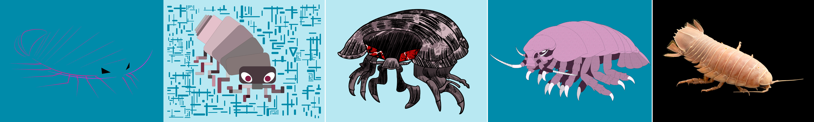

[← MEDIAART 2DF3](README.md) | [Project 2](P2-README.md)

---

# P2 – In-Class Work II: Second Composition & Print Layout Planning

*Project 2 – In Pairs with Individual Work*

<figure style="width: 100%; margin: auto;">
  
  <figcaption style="text-align: center; font-style: italic; margin-top: 0.5em;">
    Examples by previous students.
  </figcaption>
</figure>

---

## Goal

During Part 2, each student will complete their **first individual composition** and develop their **second individual composition**. The pair will also update their **Adobe InDesign planning document** and prepare a layout including four compositions and an original photograph ready for printing.

---

## Software

- **Adobe InDesign** — planning and project documentation
- **Adobe Illustrator** — vector-based composition and illustration
- **Adobe Photoshop** — raster-based composition, image manipulation, collage, texture, and digital painting

> **Do not use Image Trace in Adobe Illustrator or automated tracing techniques to generate the compositions.**

## Complete the activity in three stages

Complete the following stages in order.

<!-- 
/////////////////
SECTION 1
/////////////////
-->

  

    Stage 1: Develop the second individual composition
    
      Create the abstract composition using the visual direction and technical specifications established during Part 1.
    
  

Each student will create/complete their **second individual composition: the abstract interpretation** of the assigned animal.

The abstract composition should transform the animal through formal and conceptual experimentation rather than simply reproduce its appearance.

Consider:

- Shape simplification
- Fragmentation
- Positive and negative space
- Repetition
- Scale
- Cropping
- Gestalt principles
- Texture
- Colour
- Spatial relationships
- Visual rhythm
- Hierarchy

The animal does not need to remain immediately recognizable, but the composition should develop from its **distinctive visual, anatomical, behavioural, or textural characteristics** identified during your research.

> Avoid creating an arbitrary abstract composition. There should be a clear relationship between your research, concept, and final visual decisions.

#### Document setup

The second composition must use the **same dimensions, aspect ratio, and orientation** selected by the pair during Part 1.

Approved formats are:

| Format | Orientation |
|---|---|
| **6 × 8 in** | Portrait |
| **8 × 6 in** | Landscape |
| **6 × 6 in** | Square |
| **7 × 7 in** | Square |

> All four compositions and the original photograph must use the **same dimensions and aspect ratio**.

##### Adobe Illustrator

If working in Illustrator:

| Setting | Requirement |
|---|---|
| Units | Inches |
| Size | Same dimensions selected by the pair |
| Bleed | 0.3 in on all sides |
| Colour Mode | RGB |
| Raster Effects | High — 300 PPI |

**Required layers:**

- **Guides**
- **Composition**
- **Background**

> The Guides layer must include an inner margin guide **0.3 in from the edges**. For submission, export the Illustrator composition as a **PDF with Preserve Illustrator Editing Capabilities enabled** so the layers and vector elements remain editable.

##### Adobe Photoshop

If working in Photoshop:

| Setting | Requirement |
|---|---|
| Units | Inches |
| Size | Same dimensions selected by the pair |
| Resolution | 300 PPI |
| Colour Mode | RGB |
| Bit Depth | 16-bit recommended |

Maintain clearly organized and editable layers.

> Do not flatten the working Photoshop file. Save the final editable file as a **.TIFF** for submission.

#### File naming

Save the second composition as:

- Illustrator: `Lastname-Firstname-P2-2.pdf`
- Photoshop: `Lastname-Firstname-P2-2.tiff`

> The file type depends on the software used to create the final composition.

<!-- 
/////////////////
SECTION 2
/////////////////
-->

  

    Stage 2: Complete and revise Composition 1
    
      Finalize the first composition by addressing the instructor feedback provided after the Part 1 submission.
    
  

Each student must also **complete Composition 1** from Part 1.

The instructor will provide feedback approximately **2 days after the Part 1 submission deadline** or **during class time**. Review this feedback carefully and make all required revisions before considering Composition 1 complete.

Revisions may address:

- Concept and visual interpretation
- Composition and hierarchy
- Colour
- Shape and spatial relationships
- Texture
- Representation
- Technical execution
- Document setup
- Overall relationship to the four-piece series

> **Composition 1 must be updated according to the instructor's feedback.** The version submitted with the final project should reflect these revisions rather than the original Part 1 submission.

---

<!-- 
/////////////////
PRINTING SESSION
/////////////////
-->

  

    Stage 3: Prepare your compositions for printing
    
      Prepare and Submit the required print file with the correct settings.
    
  

<!-- Before preparing the final printing document, both students must **review and address all feedback provided by the instructor on Compositions 1 and 2**, as well as any feedback related to the **overall cohesiveness of the four-composition series**.

> Only prepare the final print file after making the required revisions to all four compositions. -->

#### Prepare the print document

Create a new **44 inches long Illustrator document**; height depends on your compositions. You must include at least 2 inches on the top and 2 inches on the bottom.

Import the final versions of all five images in a row:

1. Student 1 – Realistic or Figurative Composition
2. Student 1 – Abstract Composition
3. Student 2 – Realistic or Figurative Composition
4. Student 2 – Abstract Composition
5. Original photograph

For the four student compositions:

- Import the final **Illustrator/PDF vector files** when the work was created in Illustrator.
- Import the final **TIFF files** when the work was created in Photoshop.
- Do not flatten or unnecessarily rasterize vector-based compositions before placing them into the final Illustrator document.
- **Embed documents/images**.

> Leave at least 4 inches in-between compositions + at least 2 inches on the edges. 

#### Original photograph

Select a **high-quality photograph** of the assigned animal with enough resolution for the final print size.

You may:

- Crop the photograph to match the selected composition format.
- Resize the photograph as needed.
- Adjust its placement within the frame.

> **Do not distort or stretch the photograph.** Always maintain its original proportions when resizing.

The final photograph must use the **same dimensions and aspect ratio** as the four digital compositions.

#### Export File

Save printing file as: 

`Group-#-PrintingFile.pdf`. 

#### Final checklist

- [ ] Each student completed and revised both individual compositions.
- [ ] All four compositions use the same dimensions, aspect ratio, and orientation.
- [ ] **All imported documents/images were embedded.**
- [ ] The sheet contains the four final compositions and one high-quality original photograph.
- [ ] The print sheet preserves consistent spacing, space for trimming, and the original proportions of every image.
- [ ] Illustrator or Photoshop source files remain layered and editable.

---

## Submission 1

Each student must submit **two composition files**:

| Item | Required filename |
|---|---|
| Student 1 – Updated Composition 1 | `Lastname-Firstname-P2-1.pdf` or `.tiff` |
| Student 1 – Composition 2 | `Lastname-Firstname-P2-2.pdf` or `.tiff` |
| Student 2 – Updated Composition 1 | `Lastname-Firstname-P2-1.pdf` or `.tiff` |
| Student 2 – Composition 2 | `Lastname-Firstname-P2-2.pdf` or `.tiff` |
| Pair – Printing File | `Group-#-PrintingFile.pdf`|

> Files that cannot be opened, identified, or accessed may need to be resubmitted and may be considered late. Missing planning-document requirements, incomplete compositions, or incorrect print-layout and file settings will affect the grade.

---

Credits: Jessica A. Rodríguez
