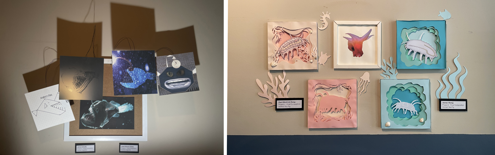

[MEDIAART 2DF3](README.md)

---

# Project 2 – Morphologies

*In Pairs with Individual Work*

<figure style="width: 100%; margin: auto;">
  
  <figcaption style="text-align: center; font-style: italic; margin-top: 0.5em;">
    Examples by previous students working with Morphologies of Animals from the Deep Sea.
  </figcaption>
</figure>

---

## Overview

In this project, students will work in **pairs** to develop a series of **four digital compositions exploring different visual interpretations of an assigned animal**.

> **The assigned animal will be announced in class. Animal selection will take place through a randomized draw.**

Each student will create **two individual compositions**:

1. **One abstract interpretation**
2. **One realistic or figurative interpretation**

Working from research and sketching through digital production and final print preparation, students will explore how the same subject can be transformed through different approaches to **form, composition, colour, image-making, visual hierarchy, and representation**.

> This project combines **collaborative planning with individual execution**. Both students are responsible for ensuring that the four compositions function together as a visually cohesive series. Follow all document setup, production, submission, and exhibition requirements outlined in each section.

## Goal

Create a cohesive five-image series that combines four individual interpretations of an assigned animal with one photographic reference. Develop the work through research, sketching, digital production, revision, printing, exhibition, and documentation.

---

## Software

- **Adobe InDesign** — planning and project documentation
- **Adobe Illustrator** — vector-based composition and illustration
- **Adobe Photoshop** — raster-based composition, image manipulation, collage, texture, and digital painting

> You may use **Illustrator, Photoshop, or a combination of both** to create the final compositions. Choose the software according to the visual approach and techniques required by your design.

#### Vector Construction and Image Trace

Students must construct their compositions using the vector drawing tools introduced in class, including shapes, paths, the Pen Tool, and Pathfinder operations.

**Image Trace or automated tracing techniques to generate compositions is strictly prohibited for this project.** 

All students must maintain their editable Illustrator files and sketches and provide them upon request to demonstrate their construction process.

---

## Index

- [Part 1 – In-Class Work I: Research, sketching, and first composition](P2-InClassWork-I.md)

<!-- 
- [Part 2 – In-Class Work II: Second composition and print-layout planning](P2-InClassWork-II.md)
- [Final submission: Exhibition and documentation](P2-Final-Submission.md) -->

---

## Course materials charged through McMaster

Estimated cost per student: **$10 CAD — charged through McMaster accounts**. This course materials charge supports both projects and includes:

- High-quality paper and printing (Project 2)
- Fine-grit sandpaper (Project 1)
- Two Birchwood sheets (0.3 in thick, 24 × 12 in) per group (Project 1)

> Costs are estimates and may change. Check Avenue to Learn for the confirmed course materials charge.

---

Credits: Jessica A. Rodríguez
